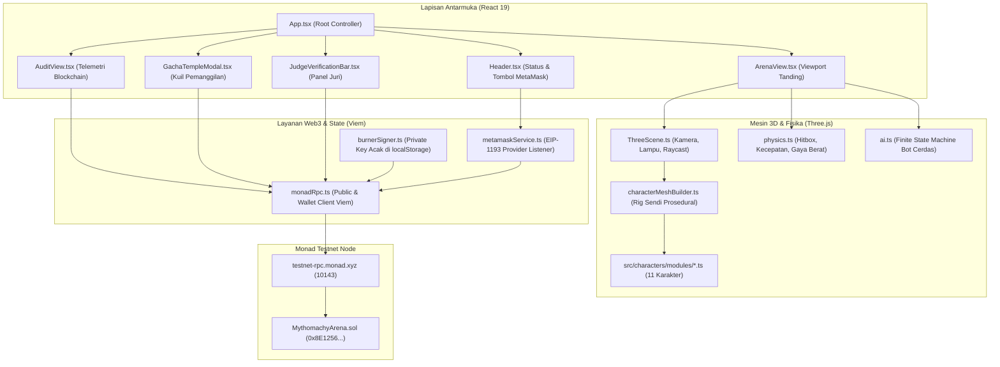
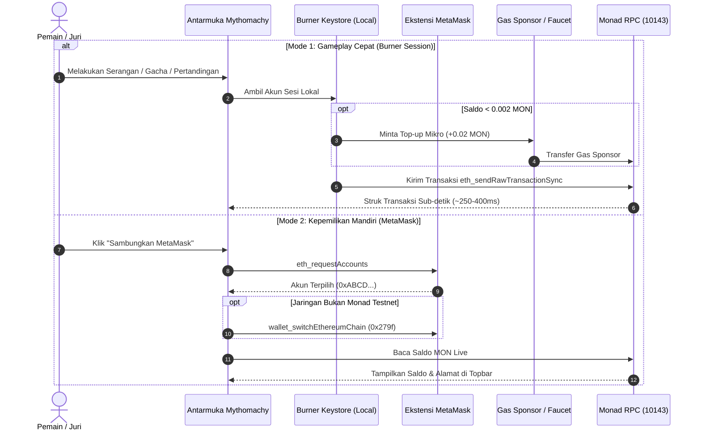

# Arsitektur Sistem Mythomachy

Dokumen ini menguraikan arsitektur teknis menyeluruh dari aplikasi **Mythomachy: Clash of Legends**, mencakup rendering grafis 3D, simulasi fisika waktu-nyata, sintesis audio prosedural, hingga integrasi blockchain Monad Testnet.

---

## 1. Tumpukan Teknologi (Technology Stack)

| Lapisan | Teknologi | Versi | Peran |
|---|---|---|---|
| **Frontend Framework** | React | `19.0.0` | Manajemen antarmuka, rendering komponen modular, dan siklus hidup aplikasi |
| **Build & Tooling** | Vite | `6.2.0` | Bundler modul berkecepatan tinggi dengan HMR sub-detik |
| **Styling & Theme** | Tailwind CSS | `4.3.3` | Utilitas CSS modern dan desain responsif |
| **3D Graphics Engine** | Three.js | `0.174.0` | Rendering WebGL, hierarki sendi 3D, pencahayaan panggung, dan raycasting |
| **Audio Engine** | Web Audio API | Native | Sintesis efek suara waktu-nyata prosedural (tanpa aset berkas audio eksternal) |
| **Web3 Client** | Viem | `2.23.0` | Komunikasi RPC Ethereum/Monad, encoding ABI, dan manajemen dompet |
| **Smart Contract** | Solidity | `0.8.24` | Logika arena on-chain, gacha pity system, pembuatan ruang, dan bitmask inventaris |
| **Jaringan Blockchain** | Monad Testnet | Chain ID `10143` | Eksekusi transaksi sub-detik dengan konsensus MonadBFT paralel |

---

## 2. Diagram Alur Data & Komponen



---

## 3. Desain Mesin 3D & Rigging Karakter Prosedural

### A. Struktur Hierarki Sendi (Articulated Rig)
Setiap karakter di Mythomachy dibangun menggunakan hierarki sendi 3D terstruktur:

```
root (Group - Koordinat Dunia & Rotasi Hadap Sumbu Y)
  │
  ├── auraGroup (Efek partikel lingkaran magis di bawah kaki)
  │
  └── torsoGroup (Group - Posisi Dada & Postur Pinggul)
        ├── torso (Mesh - Badan Utama & Armor)
        ├── chestPlate (Mesh - Plat Emas Pelindung Dada)
        ├── headGroup (Group - Kepala, Rambut, Mahkota/Helm)
        ├── leftArm (Group - Bahu, Lengan Atas, Lengan Bawah)
        ├── rightArm (Group - Lengan Senjata)
        │     └── weapon (Group - Senjata Khas Karakter)
        ├── leftLeg (Group - Paha, Kaki Kiri)
        └── rightLeg (Group - Paha, Kaki Kanan)
```

### B. Isolasi Postur Tegak (Anti-Slant Upright Isolation)
Untuk mencegah bug model miring saat menyerang atau terpelintir akibat rotasi Euler, [`characterMeshBuilder.ts`](file:///D:/projects/hack/Mythomachy/src/engine/characterMeshBuilder.ts) menerapkan isolasi ketat:
1. **Sumbu Y Eksklusif untuk Arah Hadap:** `root.rotation.y` hanya boleh bernilai `0` (menghadap depan di pedestal pameran), `+Math.PI * 0.42` (menghadap kanan ke lawan), atau `-Math.PI * 0.42` (menghadap kiri).
2. **Kunci Rotasi X dan Z pada Nol:** `root.rotation.x = 0` dan `root.rotation.z = 0` sebelum dan sesudah eksekusi animasi. Ini menjamin kedua telapak kaki karakter selalu menapak 100% tegak lurus di lantai arena (`y = 0`).
3. **Reset Baseline Setiap Frame:** Sebelum fungsi `animate()` dari modul karakter dipanggil, seluruh sendi artikulasi otomatis dipulihkan ke posisi default `(0, 0, 0)`. Hal ini mencegah kebocoran sudut (*state leak*) ketika karakter berpindah dari aksi `ATTACK` atau `HIT` kembali ke `IDLE`.
4. **Gerakan Condong pada Torso:** Dinamika condong ke depan saat lari cepat (`DASH`) atau terhentak mundur saat terkena pukulan (`HIT`) diterapkan secara anatomis pada `torsoGroup.rotation.x`, bukan pada `root`.

### C. Kamera Cerdas & Raycasting Penghalang Depan (Occlusion Handling)
[`ThreeScene.ts`](file:///D:/projects/hack/Mythomachy/src/engine/threeScene.ts) mengimplementasikan kamera dinamis yang menyesuaikan sudut pandang dan jarak berdasarkan rentang antar-petarung:
* Saat kedua petarung berjauhan, kamera secara halus mundur pada sumbu Z.
* Saat pohon atau pilar marmer kuil berada di garis pandang antara kamera dan petarung, sistem *raycaster* otomatis mendeteksi halangan tersebut dan menurunkan transparansi (*opacity*) menjadi `0.20` dengan interpolasi lembut, menjamin arena pertarungan tidak pernah tertutup oleh objek latar depan.

---

## 4. Desain Lapisan Web3 (Dual-Wallet Architecture)

Mythomachy menggabungkan kenyamanan Web2 dan transparansi Web3 melalui sistem dua dompet yang saling melengkapi:



### Keunggulan Burner Wallet:
* Kunci privat dienkripsi dan disimpan secara lokal di `localStorage`.
* Dilengkapi mekanisme pendanaan otomatis (*auto-faucet fallback*) dari kunci sponsor `VITE_TESTNET_SPONSOR_KEY` jika saldo kurang dari `0.002 MON`.
* Memungkinkan juri menguji game dalam hitungan detik tanpa setup wallet rumit.

### Keunggulan MetaMask:
* Integrasi standar industri EIP-1193 yang memberikan kendali penuh (*self-custody*) kepada pengguna.
* Otomasi deteksi dan perpindahan ke Monad Testnet (Chain ID `10143`).
* Popover dropdown informatif untuk menyalin alamat, melihat tautan Monad Explorer, dan memeriksa saldo gas live.

---

## 5. Optimalisasi Paralelisme untuk Monad

Arsitektur smart contract [`MythomachyArena.sol`](file:///D:/projects/hack/Mythomachy/contracts/MythomachyArena.sol) dirancang mengikuti prinsip optimalisasi eksekusi paralel Monad:

1. **Pemisahan Kunci Status (*State Key Isolation*):**
   Profil pengguna disimpan dalam pemetaan `mapping(address => PlayerProfile)`. Dua transaksi yang melibatkan dua pemain berbeda tidak pernah menyentuh slot memori storage yang sama, sehingga mesin *Optimistic Concurrency Control* (OCC) Monad dapat mengeksekusi kedua transaksi secara simultan pada *core* CPU yang berbeda tanpa konflik serialisasi.
2. **Bitmask Inventaris 16-Bit:**
   Alih-alih menggunakan array dinamis `uint8[]` yang memerlukan banyak pembacaan storage dan iterasi memori mahal, seluruh kepemilikan 11 legenda disimpan dalam satu field bitmask `uint16 unlockedMask`. Operasi buka karakter dilakukan melalui operasi bitwise `unlockedMask |= (1 << legendId)` dalam satu siklus `SSTORE` tunggal.
3. **Penggunaan `eth_sendRawTransactionSync`:**
   Memanfaatkan metode RPC khusus Monad untuk mengirim dan memverifikasi penyelesaian transaksi dalam satu panggilan HTTP sinkron (<600 ms), mengeliminasi kebutuhan proses polling `waitForTransactionReceipt` tradisional yang lambat.
