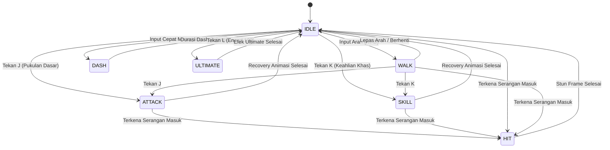

# Mesin Tempur & Rigging 3D Prosedural

Dokumen ini menjelaskan arsitektur sistem pertarungan, simulasi fisika 60 FPS, deteksi benturan (*collision detection*), serta sistem animasi prosedural 3D Three.js pada **Mythomachy: Clash of Legends**.

---

## 1. Filosofi Mesin Tempur

Mythomachy mengadopsi mekanisme pertarungan 2.5D klasik (seperti *Street Fighter* dan *Tekken*) namun dirender dalam ruang 3D penuh dengan perspektif dinamis 3/4. Karakter bertarung di sepanjang sumbu X pada bidang horizontal Z tetap, dengan fleksibilitas melompat (sumbu Y) dan orientasi kamera dinamis.

---

## 2. Siklus Fisika 60 FPS (Physics Loop)

Simulasi pergerakan petarung diperbarui setiap frame melalui `requestAnimationFrame` dengan pembatasan *delta-time* pengaman:

```typescript
const loop = (time: number) => {
  const rawDt = (time - lastTime) / 1000;
  lastTime = time;
  // Pembatasan delta-time maksimal 50ms untuk mencegah lonjakan fisika saat tab browser diminimalkan
  const dt = Math.min(rawDt, 0.05);

  updateFighterPhysics(player1, dt);
  updateFighterPhysics(player2, dt);
  checkCombatCollisions(player1, player2);
  threeScene.render(player1, player2, dt);
};
```

---

## 3. Finite State Machine (FSM) Petarung

Setiap petarung dikendalikan oleh mesin status berkeadaan hingga (*Finite State Machine*):



### Prioritas Interupsi Status:
1. `HIT`: Memiliki prioritas tertinggi. Jika petarung terkena serangan saat bersiap melakukan pukulan biasa, statusnya akan dibatalkan (*interrupted*) dan masuk ke fase stagger/recoil.
2. `ULTIMATE`: Memiliki kekebalan interupsi (*invincibility frames* atau super-armor) selama jendela aktif serangan.

---

## 4. Mekanisme Bertahan (Block & Guard)

* **Tombol Bertahan:** Tombol `S` atau `Panah Bawah` (atau tombol sentuh di layar).
* **Efek Pengurangan Kerusakan:** Bertahan sukses mengurangi kerusakan fisik sebesar **65%**.
* **Chip Damage:** Sisa 35% kerusakan tetap masuk sebagai *guard chip*.
* **Penolakan Knockback:** Menangkis serangan membagi dua jarak pantulan (*knockback distance*), mempertahankan posisi strategis pemain di arena.

---

## 5. Sistem Rigging 3D Prosedural (Procedural Joint Architecture)

Alih-alih mengunduh aset model 3D besar (puluhan megabyte format FBX/GLTF) yang memperlambat pemuatan web, Mythomachy menggunakan **arsitektur rig prosedural berbasis bentuk geometri Three.js** murni:

1. **Efisiensi Aset:** Ukuran berkas 0 KB aset eksternal; seluruh model dihasilkan langsung melalui kode program dalam hitungan milidetik saat aplikasi dimuat.
2. **Komponen Sendi Utama:**
   * `torsoGroup`: Menjadi pusat gravitasi dan rotasi postur atas.
   * `headGroup`: Dapat mengangguk, menengadah, atau menggeleng mengikuti animasi bernapas.
   * `leftArm` & `rightArm`: Bergerak independen dengan rotasi 3-sumbu untuk memukul, menangkis, dan memegang senjata khas.
   * `leftLeg` & `rightLeg`: Digerakkan secara harmonik menggunakan fungsi trigonometri sinus untuk animasi berjalan dan melompat.

### Aturan Isolasi Postur Tegak (Anti-Slant Posture Guarantee)
```typescript
// Dijalankan setiap frame di characterMeshBuilder.ts:
root.rotation.x = 0;
root.rotation.z = 0;
root.rotation.y = facing === 0 ? 0 : facing > 0 ? Math.PI * 0.42 : -Math.PI * 0.42;

// Reset sendi artikulasi ke posisi netral
torsoGroup.position.set(0, 1.0, 0);
torsoGroup.rotation.set(0, 0, 0);
headGroup.rotation.set(0, 0, 0);
leftArm.rotation.set(0, 0, 0);
rightArm.rotation.set(0, 0, 0);

// Eksekusi animasi modul karakter
charModule.animate(rigComponents, state, stateTimer, facing, dt);

// Safety clamp pasca-animasi
root.rotation.x = 0;
root.rotation.z = 0;
root.rotation.y = targetFacingY;
```

---

## 6. Raycasting Halangan Kamera (Camera Occlusion)

Di arena kuil (*Primeval Othrys*), terdapat pilar-pilar marmer dan pohon latar depan yang menambah kedalaman visual 3D. Agar aksi pertarungan tidak terhalang pandangan:
1. `ThreeScene.checkCameraOcclusion` menembakkan tiga sinar raycast dari posisi kamera aktif menuju:
   * Posisi Petarung 1
   * Posisi Petarung 2
   * Titik tengah antar-petarung
2. Jika ada mesh pohon atau pilar latar depan yang terpotong oleh sinar raycast:
   * Opacity objek diturunkan secara mulus menuju `0.20` (`transparent = true`).
3. Saat petarung berpindah dan garis pandang kembali bersih, opacity secara bertahap dipulihkan ke `1.0`.

---

## 7. Mesin Audio Terintegrasi (Synthesized Web Audio API)

[`soundEngine.ts`](file:///D:/projects/hack/Mythomachy/src/audio/soundEngine.ts) mensintesis efek suara pertarungan secara matematis menggunakan osilator frekuensi dan kurva gain:
* **Pukulan Brajamusti / Hantaman:** Gelombang segitiga (*triangle wave*) dengan modulasi pitch cepat dari 160 Hz ke 40 Hz dan white noise burst.
* **Tebasan Pedang / Tombak:** White noise melewati bandpass filter frekuensi 1200 Hz dengan kurva envelope tajam.
* **Petir Halilintar Thor:** Sawtooth wave frekuensi rendah dengan vibrato dan modulasi gain eksponensial.
* **Countdown Beep:** Gelombang sinus murni 440 Hz (pemberitahuan) dan 880 Hz (sinyal mulai pertarungan).
