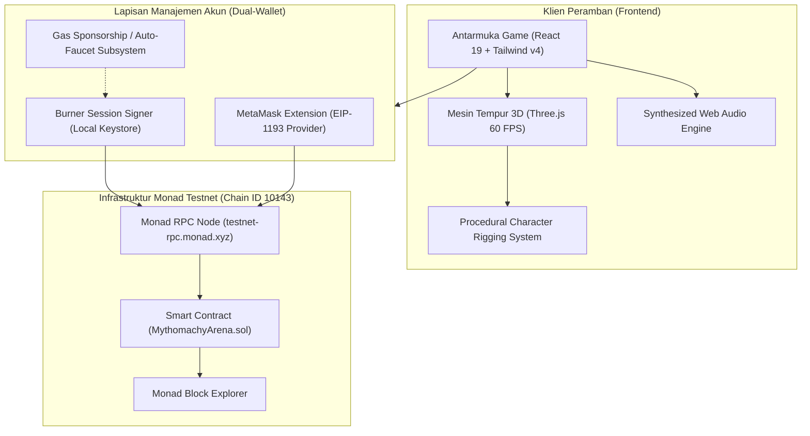

# Dokumentasi Resmi Mythomachy: Clash of Legends

Selamat datang di pusat dokumentasi resmi **Mythomachy: Clash of Legends**, game pertarungan mitologi 3D real-time Web3 pertama yang dibangun secara native untuk **Monad Testnet (Chain ID 10143)**.

---

## 1. Ikhtisar Proyek

Mythomachy memadukan ketangkasan game fighting kompetitif (60 FPS procedural 3D combat) dengan efisiensi blockchain generasi baru Monad yang berkecepatan tinggi, berbiaya rendah, dan mendukung eksekusi paralel.

Game ini dirancang untuk mengatasi hambatan adopsi Web3 (*onboarding friction*) melalui arsitektur **Dual-Wallet**:
1. **Dompet Sesi Otomatis (Burner Session Wallet):** Pemain langsung bermain tanpa instalasi dompet atau pop-up persetujuan transaksi di setiap serangan.
2. **Dompet Web3 Eksternal (MetaMask):** Pemain dan juri dapat menyambungkan dompet self-custody untuk kepemilikan aset, verifikasi saldo MON, dan penandatanganan transaksi mandiri.

---

## 2. Struktur Dokumentasi

Folder `docs/` ini memuat panduan komprehensif untuk pengembang, juri hackathon, dan pemain:

| Berkas | Deskripsi | Tautan |
|---|---|---|
| **Arsitektur Sistem** | Arsitektur menyeluruh: React 19, Three.js, State Machine, Dual-Wallet, dan Monad RPC | [ARCHITECTURE.md](file:///D:/projects/hack/Mythomachy/docs/ARCHITECTURE.md) |
| **Smart Contract & Monad** | Spesifikasi kontrak `MythomachyArena.sol`, ABI, Bitmask Karakter, Sistem Pity, dan Optimalisasi Paralel | [SMART_CONTRACT.md](file:///D:/projects/hack/Mythomachy/docs/SMART_CONTRACT.md) |
| **Mesin Tempur & 3D Rig** | Fisika 60 FPS, Hitbox/Hurtbox, Articulated Procedural Rigging, Anti-Slant Guard, dan Raycasting Kamera | [COMBAT_ENGINE.md](file:///D:/projects/hack/Mythomachy/docs/COMBAT_ENGINE.md) |
| **Panduan Karakter & Lore** | Profil lengkap, statistik dasar, keahlian khusus, dan ultimate dari 11 Legenda Lintas Mitologi | [CHARACTERS_GUIDE.md](file:///D:/projects/hack/Mythomachy/docs/CHARACTERS_GUIDE.md) |
| **Integrasi Dompet & Jaringan** | Mekanisme Burner Wallet, Faucet Otomatis, Integrasi MetaMask, dan RPC Monad Testnet | [WALLETS_AND_NETWORKING.md](file:///D:/projects/hack/Mythomachy/docs/WALLETS_AND_NETWORKING.md) |
| **Audit & Telemetri** | Panduan Dasbor Audit Blockchain, Metrik Live TPS, Nonce Inspector, dan Playground Interaktif | [TELEMETRY_AND_AUDIT.md](file:///D:/projects/hack/Mythomachy/docs/TELEMETRY_AND_AUDIT.md) |
| **Instalasi & Deployment** | Panduan setup lokal, variabel lingkungan, kompilasi Solc 0.8.24, dan deployment ke Monad | [DEPLOYMENT_AND_SETUP.md](file:///D:/projects/hack/Mythomachy/docs/DEPLOYMENT_AND_SETUP.md) |

---

## 3. Parameter Utama Jaringan Monad Testnet

* **Nama Jaringan:** Monad Testnet
* **Chain ID:** `10143` (Hex: `0x279f`)
* **RPC Endpoint:** `https://testnet-rpc.monad.xyz`
* **Mata Uang:** Monad (`MON`) - 18 Desimal
* **Block Explorer:** [https://testnet.monadexplorer.com](https://testnet.monadexplorer.com)
* **Waktu Blok:** ~400 - 600 ms
* **Finalitas:** Sub-detik (Single-slot async finality)
* **Alamat Smart Contract Aktif:** [`0x8E1256B48bF729F4a0a19Ccf22b827e81D3910A3`](https://testnet.monadexplorer.com/address/0x8E1256B48bF729F4a0a19Ccf22b827e81D3910A3)

---

## 4. Diagram Arsitektur Tingkat Tinggi

---

## 5. Ringkasan Fitur Unggulan

1. **Zero-Friction Web3 Gameplay:**
   Pemain tidak perlu menandatangani pop-up setiap memukul. Transaksi verifikasi kemenangan laga, klaim relik, dan pemanggilan karakter dilakukan di latar belakang (*silent on-chain verification*).
2. **Kuil Pemanggilan On-Chain (Gacha Pity System):**
   Sistem gacha acak dengan perlindungan *pity* on-chain: pemain dijamin mendapatkan salah satu dari 3 Karakter Apex (Gilgamesh, Nyi Roro Kidul, Chronos) paling lambat pada tarikan ke-4 atau 75 keping relik.
3. **Efisiensi Bitmask (16-bit uint):**
   Kepemilikan 11 karakter disimpan dalam 1 variabel integer tunggal on-chain, menghemat konsumsi gas storage (`SSTORE`) hingga 90% dibanding array alamat.
4. **Dasbor Audit Blockchain Bawaan:**
   Menyediakan telemetri real-time bagi juri hackathon untuk memeriksa latensi RPC, konsensus, status bitmask pemain, dan mengeksekusi uji panggil kontrak secara langsung.
