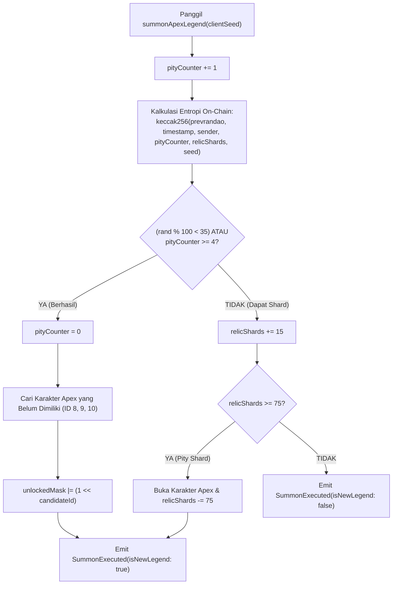

# Spesifikasi Smart Contract MythomachyArena

Dokumen ini memuat dokumentasi mendalam mengenai kontrak pintar **MythomachyArena**, struktur data, logika bisnis on-chain, sistem gacha dengan perlindungan *pity*, serta optimalisasi gas untuk **Monad Testnet**.

---

## 1. Informasi Kontrak & Deployment

* **Nama Berkas Kontrak:** [`contracts/MythomachyArena.sol`](file:///D:/projects/hack/Mythomachy/contracts/MythomachyArena.sol)
* **Kompiler Solidity:** `pragma solidity ^0.8.24;`
* **Optimalisasi:** Enabled (`runs: 200`)
* **Jaringan:** Monad Testnet
* **Chain ID:** `10143` (`0x279f`)
* **Alamat Deployment Aktif:** [`0x8E1256B48bF729F4a0a19Ccf22b827e81D3910A3`](https://testnet.monadexplorer.com/address/0x8E1256B48bF729F4a0a19Ccf22b827e81D3910A3)
* **Tautan Penjelajah Blok:** [https://testnet.monadexplorer.com/address/0x8E1256B48bF729F4a0a19Ccf22b827e81D3910A3](https://testnet.monadexplorer.com/address/0x8E1256B48bF729F4a0a19Ccf22b827e81D3910A3)

---

## 2. Struktur Data Utama

### A. PlayerProfile
Struktur data penyimpanan profil pemain yang dioptimalkan dalam 1 slot memori storage 32-byte EVM:

```solidity
struct PlayerProfile {
    uint16 unlockedMask;   // 2 byte: Bitmask kepemilikan 11 karakter (Bit 0..10)
    uint8 pityCounter;     // 1 byte: Penghitung pity pemanggilan karakter Apex (0..4)
    uint32 relicShards;    // 4 byte: Total pecahan relik yang dikumpulkan pemain
    uint32 victories;      // 4 byte: Jumlah kemenangan laga tanding
    uint32 matchesPlayed;  // 4 byte: Total pertandingan yang telah diikuti
}
// Total ukuran: 15 byte (Muat sempurna dalam 1 slot storage 32-byte tunggal!)
```

### B. Room
Struktur data antrean ruang tanding PvP antar pemain:

```solidity
struct Room {
    bytes6 roomCode;       // 6 byte kode ruang (contoh: 'MYTH01')
    address host;          // 20 byte alamat pembuat ruang
    address challenger;    // 20 byte alamat penantang
    uint8 mapId;           // 1 byte ID arena peta pertarungan
    bool isPrivate;        // 1 byte status privat/publik
    bool isActive;         // 1 byte status aktif pertandingan
    address winner;        // 20 byte alamat pemenang laga
}
```

---

## 3. Sistem Inventaris Bitmask 16-Bit

Untuk memaksimalkan efisiensi eksekusi paralel dan menekan biaya gas storage Monad, kepemilikan karakter tidak disimpan dalam bentuk array, melainkan direpresentasikan oleh **bitmask integer 16-bit**:

| ID Karakter | Nama Legenda | Kategori | Representasi Bit | Nilai Hex Bit | Terbuka Bawaan |
|---|---|---|---|---|---|
| `0` | Gatotkaca | Vanguard | Bit 0 (`1 << 0`) | `0x0001` | Ya |
| `1` | Athena | Vanguard | Bit 1 (`1 << 1`) | `0x0002` | Ya |
| `2` | Thor | Vanguard | Bit 2 (`1 << 2`) | `0x0004` | Ya |
| `3` | Susanoo | Vanguard | Bit 3 (`1 << 3`) | `0x0008` | Ya |
| `4` | Garuda | Vanguard | Bit 4 (`1 << 4`) | `0x0010` | Ya |
| `5` | Sun Wukong | Vanguard | Bit 5 (`1 << 5`) | `0x0020` | Ya |
| `6` | Quetzalcoatl | Vanguard | Bit 6 (`1 << 6`) | `0x0040` | Ya |
| `7` | Anubis | Vanguard | Bit 7 (`1 << 7`) | `0x0080` | Ya |
| `8` | Gilgamesh | **Apex Legend** | Bit 8 (`1 << 8`) | `0x0100` | Tidak (Gacha) |
| `9` | Nyi Roro Kidul | **Apex Legend** | Bit 9 (`1 << 9`) | `0x0200` | Tidak (Gacha) |
| `10` | Chronos | **Apex Legend** | Bit 10 (`1 << 10`)| `0x0400` | Tidak (Gacha) |

* **Konstanta `DEFAULT_UNLOCKED_MASK = 0x00FF` (`0b0000000011111111`):**
  Secara otomatis mengaktifkan 8 karakter Vanguard untuk seluruh pemain baru tanpa biaya gas pendaftaran akun.
* **Konstanta `ALL_UNLOCKED_MASK = 0x07FF` (`0b0000011111111111`):**
  Menandakan bahwa semua 11 legenda telah berhasil dibuka oleh pemain.

---

## 4. Sistem Gacha Kuil Pemanggilan dengan Jaminan Pity

Fungsi `summonApexLegend(uint256 clientSeed)` menjalankan pemanggilan legenda tingkat Apex (Gilgamesh, Nyi Roro Kidul, atau Chronos) dengan aturan on-chain transparan:



### Logika Keamanan Entropi:
Kombinasi `block.prevrandao`, `block.timestamp`, `msg.sender`, `pityCounter`, `relicShards`, dan `clientSeed` menghasilkan angka acak terdistribusi yang adil untuk game Web3 real-time.

---

## 5. Ringkasan Antarmuka Fungsi (ABI)

| Nama Fungsi | Tipe | Parameter Input | Output | Keterangan |
|---|---|---|---|---|
| `getPlayerProfile` | `view` | `address player` | `uint16, uint8, uint32, uint32, uint32` | Membaca bitmask karakter, counter pity, shard, menang, dan tanding |
| `summonApexLegend` | `payable` | `uint256 clientSeed` | `bool isNewLegend, uint8 legendId` | Menjalankan gacha pemanggilan legenda on-chain |
| `createRoom` | `nonpayable`| `bytes6 roomCode, uint8 mapId, bool isPrivate` | - | Mendaftarkan ruang tanding baru ke antrean publik/privat |
| `joinRoom` | `nonpayable`| `bytes6 roomCode` | - | Bergabung ke ruang tanding yang dibuat pemain lain |
| `settleMatch` | `nonpayable`| `bytes6 roomCode, address winner, uint8 hostLeg, uint8 chalLeg` | - | Memverifikasi pemenang laga dan mencatat riwayat menang |
| `getPublicRooms` | `view` | - | `bytes6[]` | Mengambil seluruh daftar kode ruang publik yang aktif |
| `getRoom` | `view` | `bytes6 roomCode` | `Room` | Mengambil detail status lengkap suatu ruang tanding |

---

## 6. Event Log On-Chain

* **`SummonExecuted(address indexed player, bool isNewLegend, uint8 legendId, uint32 totalRelicShards, uint16 updatedMask)`**
  Dipicu saat ritual pemanggilan karakter di kuil selesai.
* **`RoomCreated(bytes6 indexed roomCode, address indexed host, bool isPrivate, uint8 mapId)`**
  Dipicu saat pemain membuat ruang tanding.
* **`RoomJoined(bytes6 indexed roomCode, address indexed challenger)`**
  Dipicu saat penantang berhasil masuk ke dalam ruang.
* **`MatchSettled(bytes6 indexed roomCode, address indexed winner, uint8 hostLegend, uint8 challengerLegend)`**
  Dipicu saat laga selesai dan pemenang dicatat ke blockchain.
